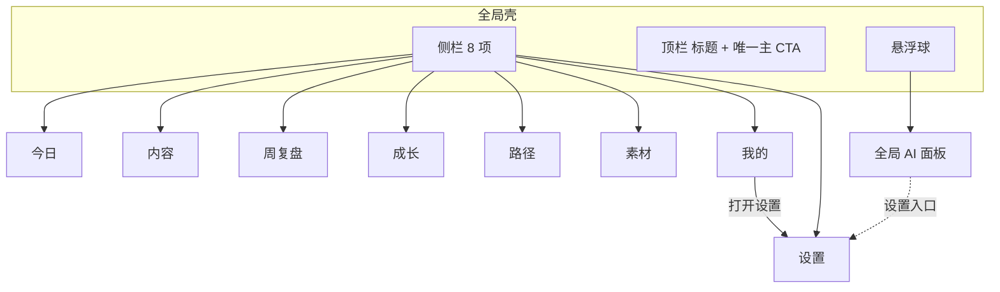
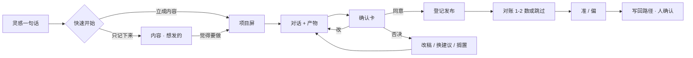
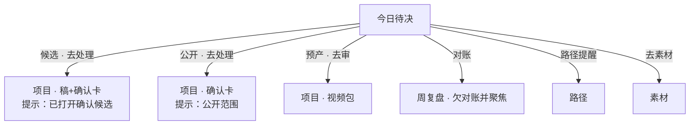
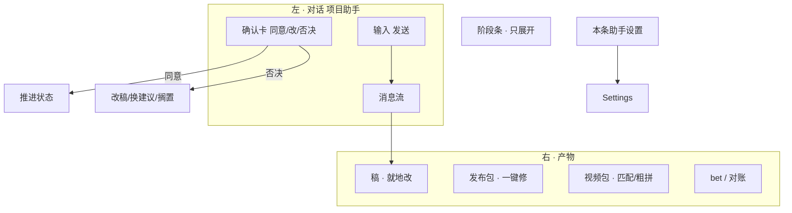
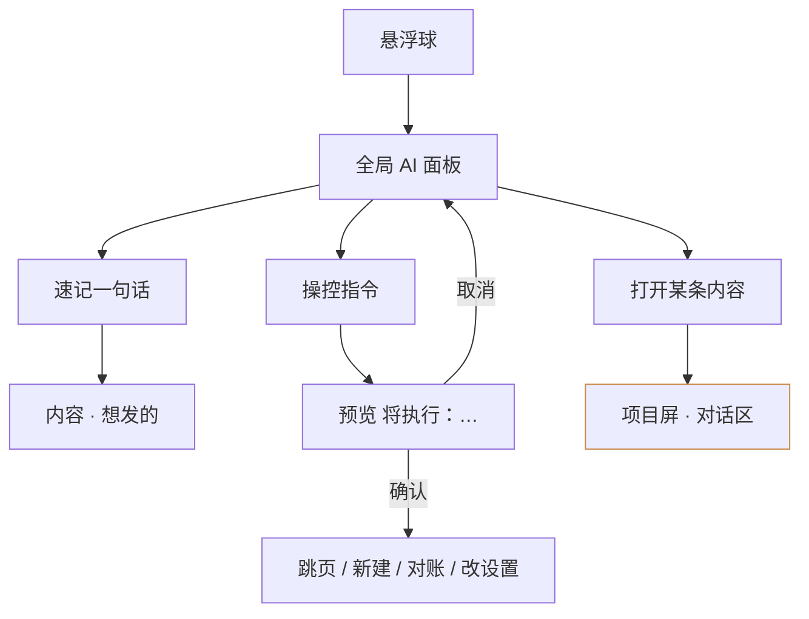
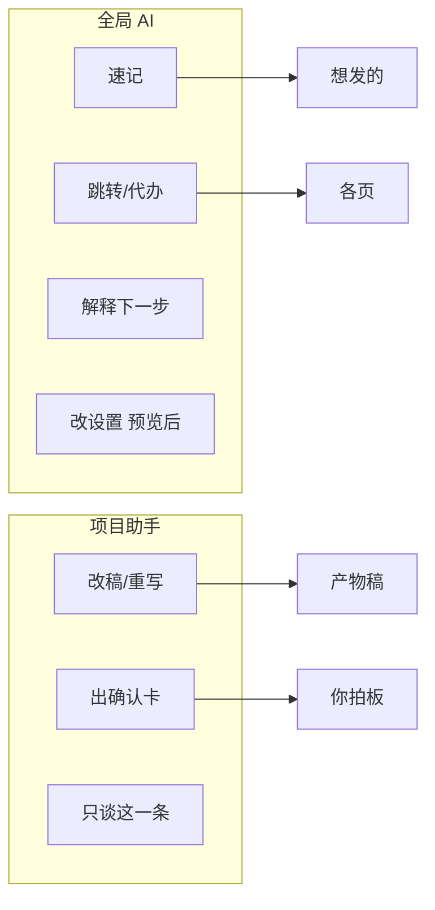
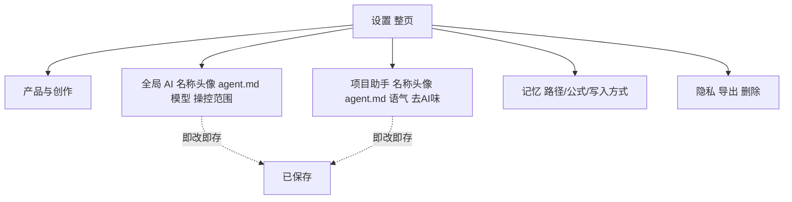
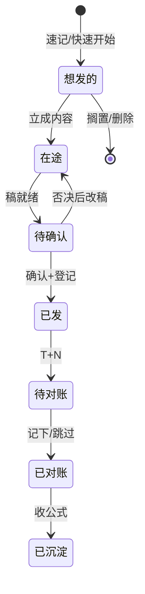
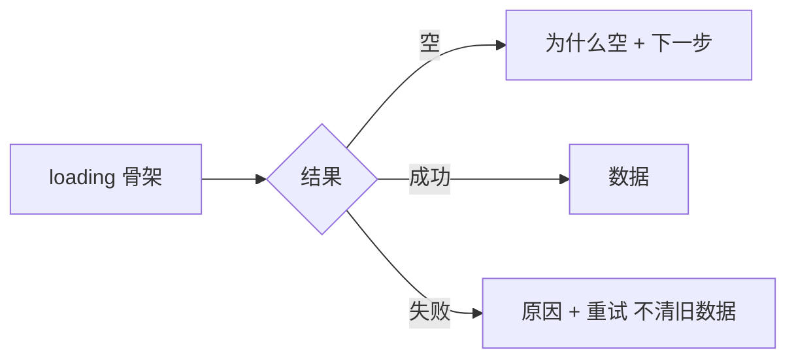

# TopicAI 内容线 · 交互架构图

> 依据：`content-line-interaction-map-v1.md` + v1.1 审查补丁  
> 节点：页面 / 浮层 / 关键动作

---

## 1. 全局导航与信息架构

---

## 2. 主链：一条内容（轻 → 重）

---

## 3. 今日 → 各锚点（跳转带提示）

---

## 4. 项目屏内部

---

## 5. 全局 AI（灵感 + 操控）

**全局 AI 不做**：改稿正文、代点确认卡、代四决策（发布/公开/长期经验/删除）。

---

## 6. 双 AI 职责

---

## 7. 设置页结构

---

## 8. 状态机（条目）

---

## 9. 错误 / 空 / 载

---

## 10. 入口对照（谁从哪进）

| 要做的事 | 主入口 | 备入口 |
|---|---|---|
| 记灵感 | 全局 AI / 快速开始 | 收件箱（素材） |
| 写一条 | 内容 · 立成内容 | 今日 · 去处理 |
| 改稿 | 项目屏 | — |
| 拍板 | 确认卡 | 全局 AI 只能「打开」 |
| 对账 | 周复盘 | 今日 · 欠对账 |
| 调路径 | 路径 | 偏离提醒 |
| 改 AI | 设置 · 全局/项目 | 项目屏「本条助手设置」 |
