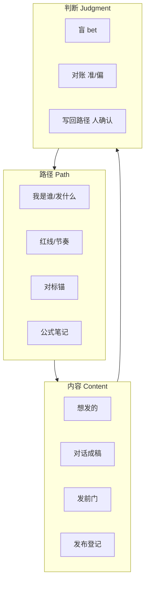
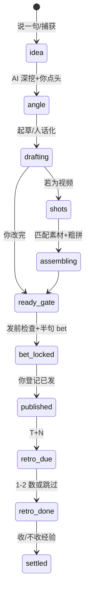
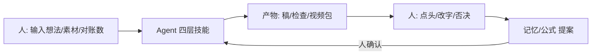
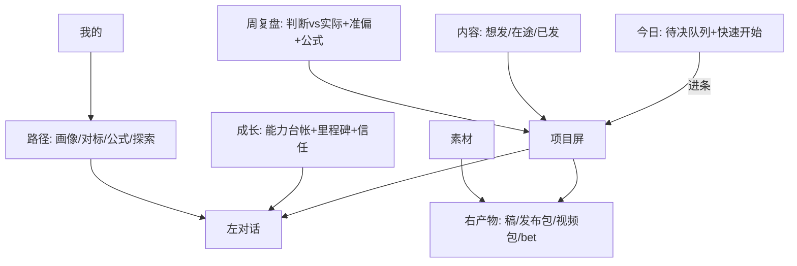
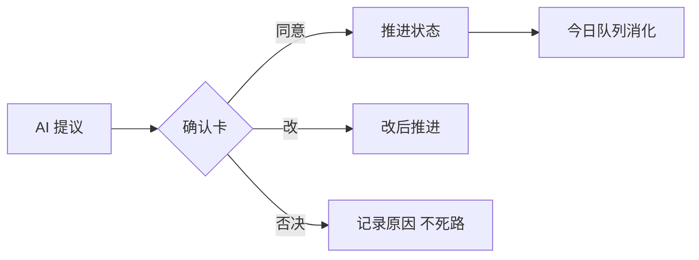
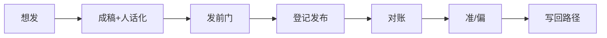
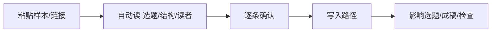
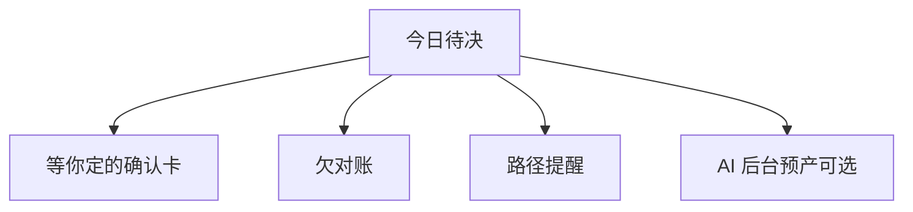

# TopicAI 内容线 · 逻辑图（确认用）

> 配套：业务 v1.1 · UX/UI v1 · 待确认 HTML 原型  
> Pencil 桌面端当前未连接，本稿先用矢量逻辑图 + HTML 原型；你打开 Pencil 后可再导入画布精修。

---

## 1. 产品三维与主闭环

---

## 2. 一条内容（条级状态机）

---

## 3. 人机分工（谁干什么）

| 人 | AI |
|---|---|
| 输入、拍板、改字、收/拒经验 | 深挖、起草、人话化、匹配、检查、对账摘要、沉淀提议 |

---

## 4. 页面信息架构（v1.1：保留成长与周复盘）

**一级导航 7 项（2026-10-11 你确认保留成长/周复盘）**  
今日 · 内容 · **周复盘** · **成长** · 路径 · 素材 · 我的

---

## 5. 确认卡（全站唯一）

类型：事实/意图/发布/长期经验 —— 同一 UI 形态。

---

## 6. 七步主链（图文）

---

## 7. 对标输入流

---

## 8. 待决队列数据源

---

（HTML 交互原型见同目录 `content-line-prototype.html`）
