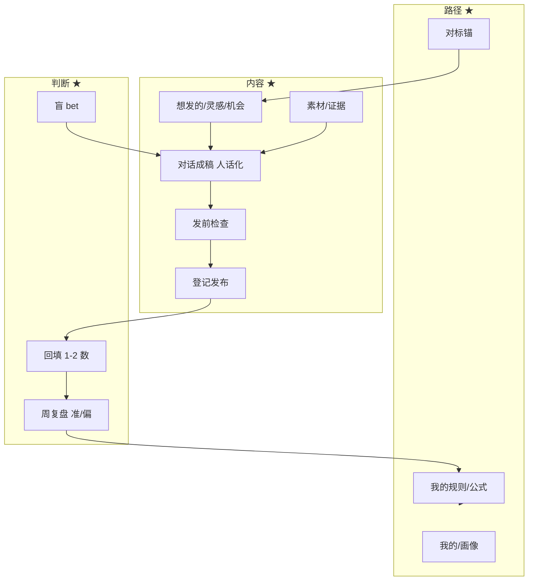

# TopicAI 现有功能盘点 · 核心/优化/删除/闭环（对齐用 v1）

> 日期：2026-10-11  
> 依据：`docs/reviews/feature-inventory.md`（17 路由 / 15 页面 / **333 控件** / **110 API**）、UAT 2026-09-19、异步闭环实走 2026-09-15、产品决策稿 v1  
> 对照模型：**路径 × 内容 × 判断**（主任务：在路径上发自己认的东西，越判越准）  
> 状态：**待你对齐**——先盘点，不定决策

---

## 0. 一句话结论

现有能力**底子厚，但摊得太开**：创作闭环其实已经能走通（产出架→工作台→发布→复盘），问题在  
① **10 个一级入口**把一条链路拆碎；② **阶段表单/校准/观点/系列**过重；③ **路径（画像）层缺失**；④ 一些入口是「管理页」而不是「干活页」。

**不是推倒重来，是收敛 + 打通 + 补路径/人味/归因。**

---

## 1. 现状面（量化）

| 维 | 数量 | 备注 |
|---|---|---|
| 一级导航 | **10**（创作 6 + 管理 4） | 晨报/产出架/收件箱/急稿/周复盘/成长 · 内容/机会/素材/我的 |
| 路由 | 17 | 含 onboarding 5 条 |
| 交互控件 | 333 | Content 簇独占 ~150+ |
| API | 110 | calibration 12 / intent_actions 13 / materials 8… |
| 后端服务 | 40+ | 含 genome / rule / viewpoint / series / opportunity… |

---

## 2. 处置总表（核心 / 优化 / 改 / 删 / 缓）

图例：★核心  ·  ◆优化  ·  ✦改造/并入  ·  ▽降级/收进  ·  ✕删除或冻结  ·  ○后续

### 2.1 创作组

| 功能 | 现状职责 | 处置 | 理由与去向 |
|---|---|---|---|
| **晨报 `/`** | 今日一条 NextBestAction + 静默计数 | ★ **核心·改** | 与「待决队列」同源；吸收产出架/急稿的入口，变成**今日唯一驾驶舱**（不是第 5 个入口） |
| **内容 `/content`** | 项目列表 + 工作台（表单海） | ★ **核心·大改** | 保留聚合；UI 改「待决 + 左对话右产物」；五阶段表单降为对话动作 |
| **收件箱 `/loop/inbox`** | 捕获素材、授权、消化成产出 | ★ **核心·并入路径** | 「捕获 → 素材」保留；「消化成产出」接到内容链路；隐私语义统一（G5） |
| **产出架 `/loop`** | 产出/灵感池、拾取 | ◆ **优化** | 「灵感池」= 找想发的；「待定产出」= 在途；与晨报/内容合并信息架构，避免三处项目列表 |
| **急稿 `/urgent`** | 三步同步建项目 | ▽ **降级** | 场景真但窄；收成内容页「快速开始」入口，独立导航可撤 |
| **周复盘 `/loop/review`** | 判断 vs 实际只读表 | ★ **核心·改** | 正是「判断」维主界面；从「周表」改为**对账 + 你准/你偏 + 写回路径** |
| **成长 `/growth`** | 能力计数、里程碑、信任 | ▽ **降级/并** | 计数易空洞；并入「我的/路径」或周复盘末尾；信任面板留下 |

### 2.2 管理组

| 功能 | 处置 | 理由与去向 |
|---|---|---|
| **机会 `/opportunities`**（30 控件） | ◆ **优化** | 保留「可解释机会」；降噪、与灵感池去重；只作**选题参照**，不替代「我想发的」 |
| **素材 `/materials`** | ★ **核心** | 证据/素材库是真实性地基；补「进稿引用」更顺 |
| **我的 `/me`** | ★ **核心** | 账号/导出/AI 配置保留；**扩展为路径画像入口**（Easel profiles） |
| **内容工作台内**：Viewpoint / Series / Rule / Calibration / Genome | ✦ **大改或冻结** | 产品重、用户难感知；规则/观点/系列**收进「判断→路径」一页**，不再四面板 |
| **Observation 窗 + 快照表单** | ✦ **简化** | 对账≤2 个数 + 可跳过；观察窗改为「过 N 天提醒」不是主状态机 |

### 2.3 引导与全局

| 功能 | 处置 | 理由 |
|---|---|---|
| Starter 三步 `/onboarding/*` | ✦ **改** | 与「选路径」重复；并成**一次路径设定**（方向/红线/节奏） |
| GrowthOnboarding / ReferenceAnchor | ★ **保留·改** | 对标冷启动 = 路径与判断的 anchor（借 cheat-learn-from） |
| Companion 悬浮球 | ◆ **优化** | 保留；但**服从内容页对话主链**，不另开一套「AI 功能」 |
| Login / Me / 404 | ★ | 基础设施 |

### 2.4 明确建议「删/冻」的（无效或超前）

| 项 | 建议 | 说明 |
|---|---|---|
| 四面板并行（Viewpoint/Series/Rule/观察列表）独立操作 | **冻结入口，数据保留** | 有模型无使用闭环；迁到判断/路径 |
| 侧栏 AI 状态写死文案 | **删假状态** | UAT A4：`AI 正常` 不读真实配置 |
| 假输入框 / 空转 CTA | **删** | 交互诚实性红线 |
| 多处重复「下一步」文案源 | **统一**（G4 已做一半） | 只留 projectListModel 一处 |
| 未达前端的冷 API（inventory §4.25） | **冻或删** | 减契约面积 |
| 「预测会爆」类文案若出现 | **永不引入** | 社区已证伪 |

---

## 3. 三维映射：什么算「核心」

**核心七件（建议 P0）**  
1. 路径画像（我的） 2. 素材/证据 3. 想发的（灵感+机会收敛） 4. 对话成稿（内嵌去 AI 味） 5. 发前检查 6. 发布登记 7. 对账复盘（准/偏→写回路径）

**其余全是支撑**，不该和核心并列一级导航。

---

## 4. 闭环链路（怎么打通）

### 4.1 主闭环：一条内容（条级）

| 步 | 现有落点 | 打通方式 |
|---|---|---|
| 想发 | 灵感池 / 机会 / 急稿 / 晨报 | 收敛为**一处「想发的」**；晨报只推「今天推进哪条」 |
| 成稿 | 工作台 + StageForms | 改对话+产物；表单动作变内联；**内嵌去 AI 味** |
| 门禁 | PublishCheck / HumanGate | 保留检查，改一键修；门禁改决策卡 |
| 发布 | PublicationForm | 简化登记；**多平台发布后置** |
| 对账 | Snapshot / BlindReview / Observation / 周复盘 | 合并为「T+N 对账」一页；输出「准/偏」 |
| 沉淀 | Rule / Viewpoint / Series | 并入路径笔记，可撤销 |

### 4.2 副闭环：捕获→素材→稿

收件箱/素材 → 引用进稿（material_usages 已有）→ 事实可溯 → 发布后仍可查。  
**要修**：隐私标签全站唯一（UAT G5/F6）。

### 4.3 副闭环：路径→内容→路径

路径画像 → 约束选题/风格/检查 → 发后对账 → 更新画像/公式（对标 ReferenceAnchor + Learn-from）。

### 4.4 副闭环：今日驾驶舱

晨报 = 待决队列（等你定 / 等对账 / 路径提醒）→ 进项目 → 回晨报。  
**砍掉**与产出架/内容页的三重项目列表。

---

## 5. 建议的信息架构（目标态，供讨论）

| 一级 | 内容 | 取代 |
|---|---|---|
| **今日** | 待决队列 + 快速开始 | 晨报 + 急稿 + 产出架合并 |
| **内容** | 想发的 / 在途 / 已发（对话项目屏） | content + 灵感池主体 |
| **复盘** | 对账、准/偏、写回路径 | 周复盘 + 校准/观察 |
| **路径** | 画像、对标、公式、红线 | 我的扩展 + 成长 + starter |
| **素材** | 库 + 引用 | 材料（+收件箱入口） |
| **我的** | 账号/AI/导出 | 保留瘦身 |

导航从 10 → **6**，且都有闭环归属。

---

## 6. 补充建议（你问「还有没有」——我认为还要加的）

| # | 补什么 | 为何 |
|---|---|---|
| S1 | **路径画像一等公民** | 现在没有「我是谁/发什么/红线」的可执行模型 |
| S2 | **内嵌去 AI 味 + 事实保真** | 发得出去的前提；用户无感 |
| S3 | **发前检查一键修**（敏感/版权/标题/平台） | Easel 已验证；现在是表单不是门 |
| S4 | **盲 bet 留底**（一句话预测 immutable） | 判断复利的前提；避免事后合理化 |
| S5 | **对账摘要「准/偏」自动生成** | 比观察窗表单更像洞察 |
| S6 | **个人公式笔记**（可版本、可回滚） | 「持续发展」的载体；比 Rule UI 轻 |
| S7 | **在途节奏（拍了没发/欠对账）** | cheat-on-content buffer；防内容烂尾 |
| S8 | **导航与页面去重** | 333 控件/10 入口是体验债本身 |
| S9 | **端到端主链 E2E 只留一条黄金路径** | 现 E2E 绑旧 DOM；重做前先锁行为 |
| S10 | **假状态与诚实性清理** | 侧栏假 AI 状态等（UAT 已点名） |

---

## 7. 与「删/改」相关的风险

| 风险 | 缓解 |
|---|---|
| 删面板导致已有数据不可见 | 入口冻结，数据/导出保留 |
| 合并晨报/产出架动了用户习惯 | 首版可保留旧路由重定向 |
| 表单改对话漏字段 | 契约字段清单对照；HumanGate 四决策不丢 |
| 范围膨胀 | 本盘点只定去向，**实现另开任务拆解** |

---

## 8. 请你拍板的对齐点（仍不急决策稿 D1–D10）

1. **是否接受导航 10→6**（今日/内容/复盘/路径/素材/我的）？  
2. **Viewpoint/Series/Rule/观察四面板**：冻结并入路径，还是保留专业页？  
3. **急稿、成长、产出架**独立入口：撤还是留？  
4. **主闭环优先打通**是否同意按 §4.1 七步？  
5. 补充项 S1–S10 有没有要砍/要加的？

---

## 9. 来源

- `docs/reviews/feature-inventory.md`（路由/控件/API 全集）
- `docs/reviews/user-acceptance-test-2026-09-19.md`
- `docs/reviews/async-loop-walkthrough-round3-2026-09-15.md`（闭环实走 5/5）
- `docs/research/content-product-decision-brief-v1.md`、`content-path-market-survey-2026-10.md`
